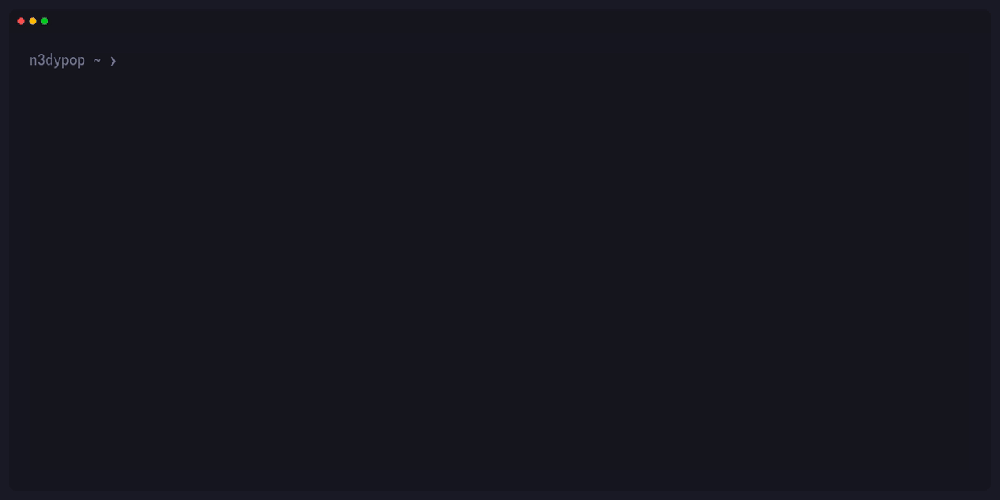

    

  <h1>Hey There, I’m n3dypop 👋</h1>
  
<strong>Building TUI applications, CLI tools, and experimental projects.</strong>

<h2>About Me</h2>

<h2>Frameworks & Tools</h2>

  

<h2>GitHub Stats</h2>
<h3>Snake</h3>

  

<h3>Development Stats</h3>

  
  

<h3>Coding Activity</h3>

  

